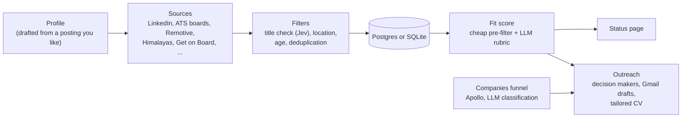

# job-search-apply

An AI-assisted job-search pipeline, run with the `jobradar` command. It finds job postings that fit **your** ideal role, scores them
with an LLM against your profile, and helps with the outreach: finding decision makers, drafting
emails and tailoring your CV.

It started as one person's search for GTM Engineer roles from Chile; everything role-specific now
lives in a profile made from a job posting you like or a description of your ideal role.

## How it works



1. **Profile** (`profile/target.md`): give it a job posting you like, or your ideal role in your own
   words, and `jobradar profile from-url <link>` (or `from-text`) writes it and keeps your text. It holds
   the keywords every job board is searched for, the location rules, and the description each posting
   is scored against. Nothing about the role lives in the code.
2. **Sources** (`jobradar sources`): one connector per job board, all going through the same
   filters, deduplication and loader. Jev, a cheap model that answers with numbers, reads each title
   and says if it is your role, in any language, before the posting is opened (on OpenRouter, a cheap
   LLM does it). Free sources run by default; paid ones (Apify) need `--paid`.
3. **Fit score** (`jobradar fit`): a cheap typed model (Jev) scores every posting and only the
   promising ones (~15%) go to the LLM, which scores each dimension of your rubric 0-100 with a
   reason. On OpenRouter every posting goes to the LLM. Python combines them: "is this really the role?" dimensions multiply the score, and so
   does "can I take it from where I live?".
4. **Status page** (`jobradar web`): interviews, pending tasks, replies and every application, live
   from the database.
5. **Outreach and CV**: decision makers via Apollo, Gmail drafts sent spaced out, and a CV per
   company built from your Google Docs master.

## Accounts you need

To use it, create an LLM account (NanoGPT or OpenRouter) and an Apify one, and put their keys in `.env`:

| Service | What it does here | Create the account | Get the key | Variable |
| --- | --- | --- | --- | --- |
| [NanoGPT](https://nano-gpt.com) (recommended) | The LLM: writes your profile, checks job titles and scores the postings | [Join](https://nano-gpt.com/join), then [add balance](https://nano-gpt.com/balance) (from US$1 by card) | [API keys](https://nano-gpt.com/api) | `NANOGPT_API_KEY` |
| [OpenRouter](https://openrouter.ai) (instead of NanoGPT) | The same, with the same models | [Sign up](https://openrouter.ai/sign-up), then [buy credits](https://openrouter.ai/settings/credits) | [API keys](https://openrouter.ai/settings/keys) | `OPENROUTER_API_KEY` |
| [Apify](https://apify.com) | The scrapers: LinkedIn, Glassdoor, Wellfound and the people at a company | [Sign up](https://console.apify.com/sign-up) (free plan: US$5 of usage a month, no card) | [API & Integrations](https://console.apify.com/settings/integrations) | `APIFY_API_TOKEN` |

NanoGPT is recommended because it also runs Jev, a cheap model that answers with numbers: it checks the
job titles and decides which postings are worth the full LLM score. OpenRouter has no Jev, so there a
cheap LLM checks the titles (in the benchmark it lost a few more good ones) and every posting gets the
full score, which costs more. With both keys NanoGPT is used; `LLM_PROVIDER` picks one.

Prices change: see [NanoGPT pricing](https://nano-gpt.com/pricing),
[OpenRouter models](https://openrouter.ai/models) and [Apify pricing](https://apify.com/pricing).

Optional, only for the outreach:

- [Apollo](https://www.apollo.io) (`APOLLO_API_KEY`, [API keys](https://app.apollo.io/#/settings/integrations/api)):
  companies and decision-maker emails.
- [Serper](https://serper.dev) (`SERPER_API_KEY`, [sign up](https://serper.dev/signup),
  [API key](https://serper.dev/api-keys)): Google results, a fallback to enrich companies.
- A [Google Cloud](https://console.cloud.google.com) OAuth client
  ([credentials](https://console.cloud.google.com/apis/credentials)): Gmail alerts and drafts, and the
  tailored CV in Drive (`GMAIL_*` variables and `jobradar google reauth`).

## Quick start

```bash
python -m venv .venv
.venv/Scripts/activate            # Windows; on macOS/Linux: source .venv/bin/activate
pip install -e ".[dev]"
cp .env.example .env              # add NANOGPT_API_KEY (or OPENROUTER_API_KEY) and APIFY_API_TOKEN; the DB is a local SQLite file
alembic upgrade head              # creates the tables in data/jobradar.db (or in your Postgres)
jobradar profile from-url "<link to a job posting you like>"   # or from-text with your ideal role
# review profile/target.md (keywords, [location]) and add your CV as profile/cv.md
jobradar sources run --free --days 7                       # the free job boards
jobradar sources run linkedin_jobs_valig --paid --days 7   # LinkedIn through Apify; also glassdoor, wellfound
jobradar fit
jobradar web                      # http://127.0.0.1:8765
```

Using a coding agent (Claude Code, Codex, ...)? [AGENTS.md](AGENTS.md) walks it through the same setup:
it gives you these links and asks you for the posting, your location and your CV.

## The profile

| Section | Drives | Default |
| --- | --- | --- |
| `role`, `[search]` | what every job board is searched for and what titles are judged against; locations; job boards of one field (`niche_sources`) | required: keywords |
| `[location]` | which locations you can take (`latam` preset, or `any`) | `any`: the LLM judges it |
| `[scoring]` | the LLM rubric: dimensions, weights, identity multiplier, eligibility | a generic rubric |
| `[companies]` | ideal employer, country, fit guide, keywords and who to contact in the companies funnel | built from the description |
| `[outreach]` | `exclude_titles`: titles never proposed to contact decision makers | none |

See [profile/target.example.md](profile/target.example.md) for every option and
[profile/examples/gtm_engineer_latam.md](profile/examples/gtm_engineer_latam.md) for a complete,
real-world profile (also used by the tests).

## Commands

`jobradar --help` lists them all; each has its own `--help`.

| Command | What it does |
| --- | --- |
| `profile check \| from-url \| from-text` | validate or draft your target profile |
| `sources list \| run \| load` | fetch, filter, deduplicate and load postings |
| `fit` | score postings against the profile (Jev pre-filter + LLM) |
| `web` | local status page of your applications |
| `companies <stage>` | companies funnel: extract, screen, enrich, classify, contacts, human review (`promote` turns on the LinkedIn monitor) |
| `decision-makers`, `apollo`, `save-contact`, `send-outreach`, `scheduled-send` | outreach |
| `cv text \| tailor` | tailored CV per company (Google Drive) |
| `scan-email`, `events`, `mark-application` | application lifecycle |
| `config --check`, `raw --purge`, `google reauth` | maintenance |

## Design

- **One client per external service** (`http_client`, `llm`, `apify`, `apollo`, `gapi`): retries that
  respect `Retry-After`, a disk cache so nothing is paid twice, real costs read from the provider,
  and calls that charge or send are never retried on a 5xx.
- **Raw data is kept as it arrives**, batch by batch, so a failure never loses what was already paid
  for; **other people's data is minimized before saving** and expires after 12 months.
- **Paid APIs and outgoing messages are opt-in**: paid sources need `--paid`, and nothing is sent
  without an explicit command.
- **One configuration registry** (`config.py`): every variable is declared once, `.env.example` is
  generated from it, and a test fails if code reads the environment anywhere else.
- **Schema through Alembic migrations** only; the models are split by topic and run on Postgres or
  SQLite.
- **Job titles are judged by a model, not by rules**: regex rules written for one role lose titles of
  any other, in silence. On 2,000 real titles of two roles, Jev lost none that were clearly the role, a
  cheap LLM lost 23 and the rules 189. Each answer is kept, so no title is paid twice.
- **Behavior-preserving refactors**: the location filter was checked against 37,170 real postings
  (0 differences) when it moved from code to the profile.

## Costs

Free: LinkedIn public pages, ATS boards (Ashby, Greenhouse, Lever, Workable), Remotive, Himalayas,
Get on Board and the Gmail job alerts. Through NanoGPT, the title check costs about US$0.002 per 1,000
new titles, the Jev pre-filter about US$0.0001 per posting and the LLM score a fraction of a cent for
the ~15% that reach it. On OpenRouter the title check costs about the same, but every posting gets the
LLM score. Apify sources charge per posting and every run carries a spending cap.

## Development

```bash
pip install -e ".[dev]"
pytest                    # no network, no secrets: SQLite and the example profile
ruff check . && ruff format --check .
python dev/scan_public.py --path .   # personal data, credentials and forbidden files; runs in CI
python dev/verify.py --out now.json --compare base.json   # imports, every CLI's --help, pytest, ruff
```

## License

[MIT](LICENSE).
